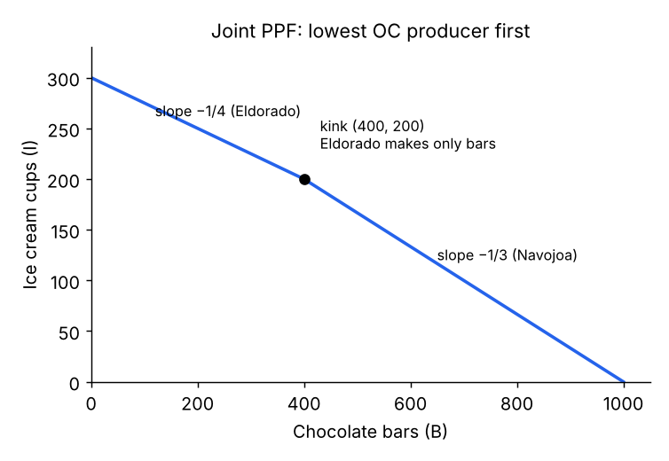

# Topic 1 – Introduction to Economics

Question → answer notes, generated from the RECALL deck. ⭐ = asked in a past midterm.

## 01. The concept of Economics

**Q:** How did **Lionel Robbins** (1932) define economics?

The science that studies human behaviour as a relationship between **ends** and **scarce means** which have **alternative uses**.

> The key word is **scarcity**: we have unlimited wants but limited resources, so every use of a resource means giving up another use. That is why opportunity cost is at the heart of economics.

**Q:** How did **Adam Smith** describe economics?

A study of mankind in the **ordinary business of life** – the part of action connected with the attainment and use of the **material requisites of well-being**.

**Q:** Why is economics called a **social science**?

It uses the **scientific method**: build **theories**, state **hypotheses**, test them with **empirical data** (hence statistics/data analytics matter).

**Q:** Economics is not about money – what is it about, and which two criteria does it judge policies by?

It is about **well-being**. Policies are judged by **efficiency** (best use of resources) and **equity** (fair distribution of income).

**Q:** Golden rule when analysing economic data?

**Correlation does not imply causality.**

> Example from Seminar 1: GDP per capita and primary school enrolment move together, but a scatterplot alone cannot prove that higher GDP *causes* higher enrolment. You need e.g. a natural experiment.

**Q:** Name connections between economics and other disciplines (slides).

- **Psychology** → behavioural economics
- **International relations**
- **Law** → competition law
- **Maths** → models to express theories

## 02. Micro vs Macro

**Q:** What does **microeconomics** analyse?

**Specific markets**: market structures, incentive design, **consumer choice**, firms' **strategic decisions**.

**Q:** What does **macroeconomics** analyse?

The whole economy: **economic growth**, **inflation**, **unemployment**, **inequality**, **fiscal** and **monetary policy**.

**Q:** Are micro and macro independent?

No – they are **linked**. Models of consumers' and firms' behaviour (micro) are the **base** for macro models; the fields differ in **focus**.

**Q:** What is **econometrics**?

The application of **statistical methods** to economic analysis.

**Q:** Micro or macro? (a) A €4 tariff – does the consumer price rise by €4 or less? (b) Do higher interest rates reduce inflation and growth?

(a) **Micro** (one market, tax incidence). (b) **Macro** (monetary policy, aggregate inflation/growth).

## 03. Opportunity cost & PPF

**Q:** Define **opportunity cost**. (asked in BOTH past midterms) ⭐

The **value of the next-best alternative** given up when a decision is made – **what we give up** by taking a certain decision.

**Q:** Adam: taxi driver 2,000 h × €20; licence + car cost €100,000 (could earn **4%**); alternative job pays €37,000. Opportunity cost of being a taxi driver? Rational?

OC = **€37,000** salary + **€4,000** interest = **€41,000**. Taxi earns **€40,000** < €41,000 → **not rational** (economic loss of €1,000).

> Opportunity cost includes *all* forgone alternatives: the best alternative salary AND the interest the €100,000 could have earned in the bank. If interest rates rise, the forgone interest rises, so becoming a taxi driver becomes **even less** attractive.

**Q:** In the taxi example, if interest rates **increase**, is Adam more or less likely to become a taxi driver?

**Less likely** – the forgone interest on the €100,000 rises, so the **opportunity cost increases**.

**Q:** Youth unemployment falls and young unskilled wages rise. What happens to the opportunity cost of going to university? (Midterm 2023) ⭐

It **increases**: lower unemployment → higher **expected wages without a degree** → more **forgone earnings** during the years at college.

**Q:** Paper: "Tourism growth, education decline" (China). Most likely explanation?

Tourism creates jobs → **raises the opportunity cost of attending college** (forgone wages) → fewer students.

**Q:** ECB raises interest rates. Effect on the opportunity cost of real-estate investors? (Midterm 2025 + Seminar 1) ⭐

**Increases**: bonds/bank deposits become more attractive (higher forgone return) **and** borrowing costs rise.

**Q:** Turkish lira depreciates vs the British pound. Effect on the opportunity cost of a British tourist going to **Spain**? (Midterm 2025) ⭐

**Increases** – Turkey becomes cheaper, so the forgone alternative (holiday in Turkey) is more valuable → higher OC of visiting Spain.

**Q:** Relationship between the hourly wage and time spent on leisure (opportunity cost view)?

A higher wage **raises the opportunity cost of leisure** (each hour of leisure = more forgone income).

**Q:** What does the **PPC/PPF** represent?

The **maximum production** of two goods an economic system (country, firm…) can produce with its resources and technology.

**Q:** What does the **slope** of the PPF represent?

The **opportunity cost**: how many units of the **vertical-axis** good we give up for **one more unit** of the **horizontal-axis** good.

**Q:** Why can a PPF be **curved (bowed out)**?

**Increasing opportunity costs**: we start with the most efficient resources, so producing more of one good gets harder and harder.

**Q:** How do **more or fewer resources** show on the PPF? Do opportunity costs change?

A **parallel shift** (out/in). OCs **do not change** (slope unchanged).

> Seminar 1, Q1d: the AI system loses 18 hours → frontier shifts inward in parallel from M + 4P = 40 to M + 4P = 34, OC(M) = 0.25P still.

**Q:** How does a **productivity/technology change** in one good show on the PPF?

The **slope changes** (the PPF pivots) → opportunity costs of **both** goods change.

> Seminar 1, Q1e: policy analysis now takes 9 h instead of 12. OC(P) falls from 4M to **3M**, and OC(M) rises from 0.25P to **1/3 P** – even though maths still takes 3 h. OCs are always reciprocals of each other.

**Q:** If the OC of 1 car = **6 motorbikes**, what is the OC of 1 motorbike?

**1/6 car** – opportunity costs of the two goods are **reciprocals**.

**Q:** 2,000 employees; each can make **20 phones or 4 laptops** a day. Max output and opportunity costs?

Max **40,000 phones** or **8,000 laptops**. OC(phone) = **0.2 laptops**; OC(laptop) = **5 phones**.

## 03. Comparative advantage

**Q:** What is **comparative advantage**?

Producing a good at a **lower opportunity cost** than others. Each country **specialises** in the good with the lower OC.

**Q:** Country A is better at producing **everything**. Can both A and B still gain from trade?

**Yes** – as long as their **opportunity costs differ**, both gain by specialising according to **comparative** (not absolute) advantage.

**Q:** Where must the **international price** (terms of trade) lie for both countries to gain?

**Between the two countries' opportunity costs.**

**Q:** A: 1 labour unit → **5 laptops or 10 phones**; B: **1 laptop or 3 phones** (100 labour each). Who has the comparative advantage in what? Price range?

OC(laptop): A = **2 phones**, B = **3 phones** → **A: laptops**, **B: phones**. Trade price: **2–3 phones per laptop**.

> A has an absolute advantage in both goods, but its OC of laptops is lower (2 < 3 phones), and B's OC of phones is lower (1/3 < 1/2 laptop). Merged country C: max 600 laptops or 1,300 phones; kink at (500 laptops, 300 phones) – A makes all laptops first.

**Q:** How do you build a **joint PPF** of two producers?

Start with **all output of one good**; switch to the other good first in the producer with the **lower opportunity cost** for it. Their full switch gives the **kink**; then the second producer switches.

## 04. Positive vs normative

**Q:** What is a **positive** statement?

**Objective** – it can be **tested or verified** with data (may be true or false).

**Q:** What is a **normative** statement?

Contains a **value judgement** ("should", "better", "good for society").

**Q:** Positive or normative? (1) Minimum wages are associated with higher youth unemployment. (2) Progressive taxes are better than proportional. (3) More inequality is associated with higher crime.

(1) **Positive** (2) **Normative** (3) **Positive**

**Q:** "Inflation has reached a 20-year record. Lowering taxes is the best option to fight inflation." Positive or normative? (Midterm 2023) ⭐

First part **positive** (verifiable). "Best option" = value judgement → the statement is **normative**.

**Q:** What is a **natural experiment**, and what does it require?

An event that splits people into **treatment** and **control groups** that are **comparable in all relevant characteristics** except exposure to the event.

> Classic slide example: **Card & Krueger** (Nobel 2021 with Angrist & Imbens). New Jersey raised its minimum wage in 1992 ($4.25 → $5.05); neighbouring eastern Pennsylvania did not. Fast-food employment in NJ did **not** fall.

**Q:** What did **Card & Krueger** find about the New Jersey minimum wage increase?

Comparing NJ (treatment) with eastern **Pennsylvania** (control): **employment was not affected** despite the higher minimum wage.

## 05. Market structures

**Q:** Order the four market structures from **least to most market power**.

**Perfect competition** → **monopolistic competition** → **oligopoly** → **monopoly**.

**Q:** Perfect competition: number of sellers, product, control over price, entry?

**Very large** number · **standardized** product · **no** control over price · **no barriers**.

**Q:** Monopolistic competition: number of sellers, product, control over price, entry?

**Many** sellers · **differentiated** product · **slight** control over price · **no barriers** (→ long-run entry pushes profits down).

**Q:** Oligopoly: number of sellers, product, control over price, entry?

**Few / two** sellers · **standardized or differentiated** · **considerable** control over price · **large barriers**.

**Q:** Monopoly: number of sellers, product, control over price, entry?

**One** seller · **unique** product · **huge** control over price (if not regulated) · **very large barriers**.

**Q:** 4 hotels on a Greek island, differing in rating, beach distance and price. Market structure? Product type? (Seminar 1)

**Oligopoly** (only 4 firms, strategic interdependence, high HHI) selling a **differentiated** product (rating, location, quality differ).

## 06. Market concentration (HHI)

**Q:** Define the **Herfindahl-Hirschman Index** and give its formula. ⭐

A measure of **market concentration**: **HHI = Σ sᵢ²** – the sum of the **squared market shares** (in %) of all firms.

**Q:** Range of the HHI in general?

From **close to 0** (many tiny firms) to **10,000** (monopoly: 100²).

**Q:** Minimum HHI with **n** firms? Give values for 3 and 4 firms. ⭐

Minimum when shares are **equal**: **10,000 / n**. 3 firms → **3,333.3**; 4 firms → **2,500**.

> With 4 firms with positive shares the HHI ranges from 2,500 (25% each) to values arbitrarily close to, **but below**, 10,000 (it can never reach 10,000 while all four have a positive share).

**Q:** What is the negative impact of a **higher HHI**? ⭐

Higher concentration → **less competition** → **collusion more likely** → **lower output** and **higher prices** (more market power).

**Q:** Shares 40, 20, 18, 12, 10. HHI? New HHI if C, D and E merge?

HHI = 1,600 + 400 + 324 + 144 + 100 = **2,568**. After merger (40, 20, 40): **3,600**.

**Q:** France: 80/15/5. Italy: two firms, one with 55%. Which is more concentrated? (Midterm 2023) ⭐

France = 6,400 + 225 + 25 = **6,650**; Italy = 55² + 45² = **5,050** → **France** is more concentrated.

**Q:** EU merger guidelines: when is the Commission unlikely to see competition concerns?

Post-merger HHI **< 1,000**; HHI **1,000–2,000** with Δ **< 250**; HHI **> 2,000** with Δ **< 150**.

## 07. Perfect competition & information

**Q:** The **four conditions** of perfect competition?

1. **Many sellers** of an **identical product**
2. **Many buyers**
3. **Symmetric and complete information**
4. **Free entry and exit**

**Q:** Why are firms **price-takers** in perfect competition?

**Identical product** → consumers buy the cheapest, so all sell at **one market price**; and **no firm is large enough** to lead the price.

**Q:** What profit do firms make in the **long run** under perfect competition, and why?

**Zero economic profit** – they earn their **opportunity cost**. Profits attract **entry**; losses cause **exit**.

**Q:** Give two examples of **asymmetric information** from the slides.

Job **candidates** know more about their skills than **employers**; **manufacturers** know more about quality than **consumers**.

**Q:** What is **Akerlof's "Market for Lemons"** (1970) about?

**Adverse selection**: sellers know quality, buyers don't → buyers' **WTP falls** → **good-quality sellers leave** → market share of bad quality rises (market may **collapse**).

> Used-car market: a 'lemon' is a defective car. Because buyers can't tell good from bad cars, they only pay an average price; owners of good cars won't sell at that price, so the average quality falls further. Nobel 2001.

**Q:** How can asymmetric information be reduced? (slides)

**Ratings and reviews** (e.g. booking platforms, Michelin stars), certifications, guarantees – signals of quality.

