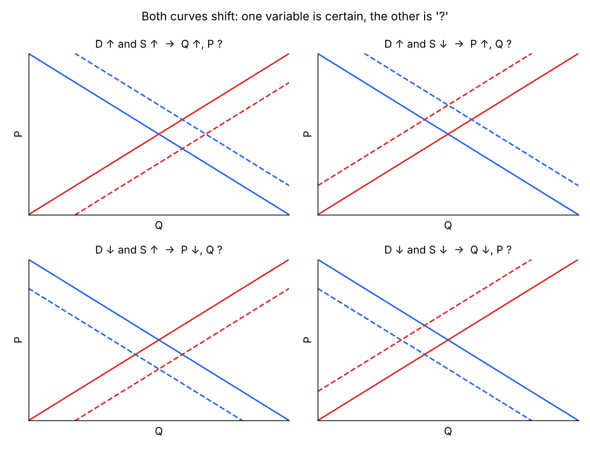
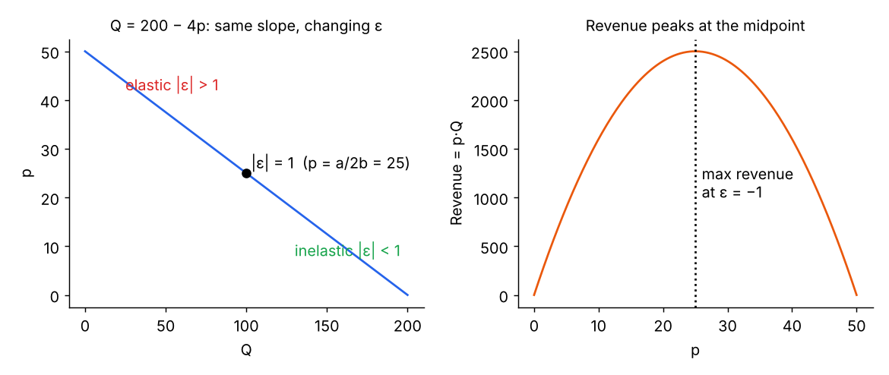
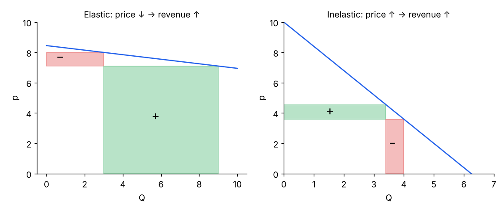

# Topic 2 – Market Analysis

Question → answer notes, generated from the RECALL deck. ⭐ = asked in a past midterm.

## 01. Demand, supply, equilibrium

**Q:** State the **law of demand** and the **law of supply**.

Demand: price ↑ → **quantity demanded ↓** (negative slope). Supply: price ↑ → **quantity supplied ↑** (positive slope).

**Q:** What is **market equilibrium** and how do you find it from equations?

Where **Qd = Qs**. Set the two equations equal, solve for **p\***, then plug p\* into either equation for **Q\***.

**Q:** Demand shifts right. When is the **price** effect big and when is the **quantity** effect big?

Depends on supply responsiveness: **inelastic supply** → mostly **price ↑**; **elastic supply** → mostly **quantity ↑**.

**Q:** Supply shifts. What determines whether price or quantity changes more?

**Demand elasticity**: inelastic demand → big **price** change; elastic demand → big **quantity** change.

## 02. Demand and its drivers

**Q:** Write the general demand function and list its drivers.

**Qd = f(P, P_subst, P_compl, income, tastes…)** – own price, price of **substitutes**, price of **complements**, **income**, **preferences**.

**Q:** Movement **along** the demand curve vs **shift** of the curve?

Change in **price (variable)** → movement **along** (change in quantity demanded). Change in a **parameter** (income, preferences, related prices) → **shift** of the whole curve (change in demand).

**Q:** Price of a **substitute** rises (Pepsi ↑). Effect on demand for Coke?

Demand for Coke **increases** (shifts right).

**Q:** Price of a **complement** rises (flights BCN–NY ↑). Effect on hotel rooms in NY?

Demand for hotel rooms **decreases** (shifts left).

**Q:** Income rises. Effect on a **normal** vs an **inferior** good?

Normal good: demand **↑**. Inferior good: demand **↓**.

> Slide study: fast-food restaurants were *normal* goods for below-average incomes but *inferior* for above-average incomes; full-service restaurants were normal at virtually all income levels.

**Q:** List what causes an **increase in demand** (shift right).

- Income ↑ (normal) / income ↓ (inferior)
- Price of **substitute ↑**
- Price of **complement ↓**
- Preferences ↑
- More **population** interested

**Q:** What does the **utility function** measure?

How consumers **feel** (satisfaction) given a certain **basket of products**. Demand depends on preferences and **budget constraints** (time/money).

**Q:** What is a **Giffen good**? Example?

A good whose demand **rises when its price rises** (violates the law of demand) – the income effect dominates. Example: **potatoes in 19th-century Ireland**.

**Q:** How do you get **market demand** from individual demands?

**Horizontal sum**: at each price, **add the quantities** (× number of consumers). Only add groups whose quantity is ≥ 0 → kinked demand.

> Seminar 2 Q5: 50 business travellers Qd = 100 − 4p and 100 leisure travellers Qd = 100 − 2p.
> - p ≤ 25: Q = 5,000 − 200p + 10,000 − 200p = **15,000 − 400p**
> - 25 < p ≤ 50: only leisure → **Q = 10,000 − 200p**
> - p > 50: Q = 0. Kink at (5,000, 25).

## 03. Supply and its drivers

**Q:** What does quantity supplied depend on?

**Technology/productivity**, **number of firms**, **own price**, **price of related products** (that the firm could switch to), **cost structure** (marginal costs).

**Q:** Do **fixed costs** affect the supply curve?

**No** – only **marginal (variable) costs** affect supply. A fixed cost has no consequence on supply.

**Q:** TFC = €200; TVC = 50, 110, 200 for Q = 1, 2, 3. Minimum price to sell each additional unit?

MC = **€50, €60, €90**. The minimum price for an extra unit = its **marginal cost** (not average total cost – profit is a different question).

**Q:** List what **increases supply** (shift right) and what **decreases** it.

Increase: **more firms**, **productivity ↑**, **wages ↓**, other variable costs ↓, **technological change**.
Decrease: fewer firms, **wages ↑**, variable costs ↑, **shortage of production factors**.

**Q:** Linear supply Qs = β₀ + βₓPₓ + β_W·W + β_r·P_r: expected signs?

**βₓ > 0** (law of supply); **β_W < 0** (input price ↑ → supply ↓); **β_r > 0** for complements in production.

## Market dynamics (shifts)

**Q:** Both curves shift at once. What can you say?

Only **one** variable is certain; the other is **ambiguous (?)** – it depends on which shift is larger.
- D↑ S↑ → **Q↑, P?**
- D↑ S↓ → **P↑, Q?**
- D↓ S↑ → **P↓, Q?**
- D↓ S↓ → **Q↓, P?**

**Q:** AI raises consulting productivity; fear of recession makes clients reluctant to start projects. New equilibrium? (Midterm 2025) ⭐

Supply **↑** (right) and demand **↓** (left) → **P ↓**, **Q uncertain**.

**Q:** Mallorca clubs: tourists spend more on hotels (less on nightlife) + rising operational costs. Effect? (Midterm 2025) ⭐

Demand **↓** and supply **↓** → **Q ↓**, **price uncertain**.

**Q:** Oil: demand keeps growing + Saudi Arabia cuts production. Effect? (Midterm 2023) ⭐

Demand **↑** and supply **↓** → **P ↑**, **Q uncertain**.

**Q:** Rumour that Banksy will retire; number of works fixed in the short run. Effect?

Demand **↑** with **vertical (perfectly inelastic) supply** → **P ↑, Q unchanged**.

**Q:** NYC heavily restricts short-term rentals. Effect on the hotel market? With fixed capacity of 120,000 rooms?

Short-term rentals are **substitutes** → hotel demand **↑** → **P ↑, Q ↑**. With capacity reached, supply becomes **vertical** → P ↑, Q ↑ **at most 120,000**.

**Q:** Lira loses 18% vs the euro. Turkish tourism market (prices in lira)?

Turkey becomes cheaper for foreigners → **demand ↑** → **P (in TRY) ↑, Q ↑**.

**Q:** 50% US tariff on Canadian maple syrup + US consumers boycott Canadian products?

Supply **↓** (tariff) and demand **↓** → **Q ↓, P ?**

**Q:** London: public land for new flats + higher variable mortgage rates?

Supply **↑** and demand **↓** → **P ↓, Q ?**

## 04. Elasticities

**Q:** What does **elasticity** measure? Name the three demand elasticities.

How **sensitive** quantity demanded is to a change in a variable: **price elasticity (PED)**, **cross-price elasticity (XED)**, **income elasticity (YED)**.

**Q:** Formula for the **price elasticity of demand**?

**ε = %ΔQ / %ΔP = (ΔQ/Q₀)/(ΔP/P₀) = (ΔQ/ΔP)·(P₀/Q₀)**; point form **ε = Q'(p)·p/Q(p)**. Use **initial values** for the %.

**Q:** What sign does PED have?

**Negative** (law of demand), except when it is **zero**.

**Q:** Value ranges: elastic, unit, inelastic, perfectly inelastic, perfectly elastic.

- **−∞ < ε < −1**: elastic
- **ε = −1**: unit elastic
- **−1 < ε < 0**: inelastic
- **ε = 0**: perfectly inelastic (vertical D)
- **ε = −∞**: perfectly elastic (horizontal D)

**Q:** Is the slope of a linear demand the same as its PED? ⭐

**No.** Slope is **constant**, but PED **changes along the line**: **elastic at high prices** (small Q → big % changes), **inelastic at low prices**.

> ε = (dQ/dp)·(p/Q). dQ/dp is constant, but p/Q rises as price rises (p up, Q down). So demand becomes **more elastic as price increases**.

**Q:** For linear demand **Q = a − bp**, what is the PED and the revenue-maximising price? ⭐

**ε = −bp/(a − bp)**. Revenue is max where **ε = −1** → **p = a/(2b)** (the midpoint).

**Q:** Total revenue test: price ↑ with **inelastic** vs **elastic** demand?

Inelastic: price ↑ → **revenue ↑** (price ↓ → revenue ↓).
Elastic: price ↑ → **revenue ↓** (price ↓ → revenue ↑).
Unit elastic: revenue **unchanged**.

**Q:** Explain with a diagram: prices drop in a market with **very elastic** demand. (Midterm 2025) ⭐

Revenue **rises**: the loss rectangle (**ΔP × Q₁**) is smaller than the gain rectangle (**P₂ × ΔQ**) because Q rises by a larger %.

**Q:** Is maximum revenue the same as maximum profit?

**No** – maximum revenue is at **ε = −1**; profit also needs the **cost structure**.

**Q:** Five determinants of PED (slides)?

1. **Time**: more elastic in the **long run**
2. **Necessity**: basic goods (food, housing, electricity) inelastic
3. **Number of substitutes**: few → inelastic
4. **Addictiveness**: alcohol, cigarettes, drugs inelastic
5. **Share of budget**: big share → more elastic

**Q:** PED of marijuana ≈ −0.7. Is a tax that raises the price a good way to cut consumption?

Demand is **inelastic** → a tax reduces quantity **only a little** (but raises a lot of tax revenue).

**Q:** Relationship between PED and income? (drug-price slide)

**Lower income/education → more price-sensitive** (more elastic) – relevant for **social justice** of price policies.

**Q:** Define **income elasticity**; classify normal (luxury/necessity) and inferior goods.

**ε_R = %ΔQ / %ΔIncome**. **> 1** luxury · **0–1** necessity (both **normal**, > 0) · **< 0** **inferior**.

**Q:** What is the **Engel curve**?

Shows **quantity demanded** (horizontal axis) against **income** (vertical axis); bends backwards where the good becomes **inferior**.

**Q:** Define **cross-price elasticity**; what do its signs mean?

**ε_XY = %ΔQ_X / %ΔP_Y**. **Positive** → **substitutes**; **negative** → **complements**. Close to 0 → weakly related.

**Q:** Define the **price elasticity of supply**. Sign?

**ε_S = %ΔQs / %ΔP** – **positive** (upward-sloping supply); **0** if supply is perfectly inelastic (vertical).

## 05. Welfare analysis

**Q:** What is **consumer surplus**?

Sum of **WTP − price** over all units bought; graphically the area **below demand and above the price**.

**Q:** What is **producer surplus**? Is it equal to profit?

Sum of **P − MC** over all units sold = **revenues − variable costs**; area **above supply, below price**. **Not profit** (fixed costs excluded).

**Q:** WTP per unit: 15, 10, 8, 5, 3; price €6. Consumer surplus?

Buys 3 units: (15−6) + (10−6) + (8−6) = **€15**.

**Q:** Price €12; MC per unit: 4, 7, 10, 13, 16. Producer surplus?

Sells 3 units: 8 + 5 + 2 = **€15** (units 4–5 have MC > P).

**Q:** Why can the demand curve be read as **WTP**?

Each point = WTP for that unit; **marginal utility decreases** as consumption increases → downward slope.

**Q:** Purpose of welfare analysis?

Measure the welfare of each stakeholder (**CS, PS**) to compare two market situations: **who wins, who loses**, and whether **total welfare** rises or falls (taxes, price controls…).

