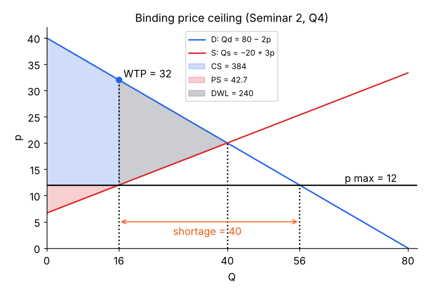
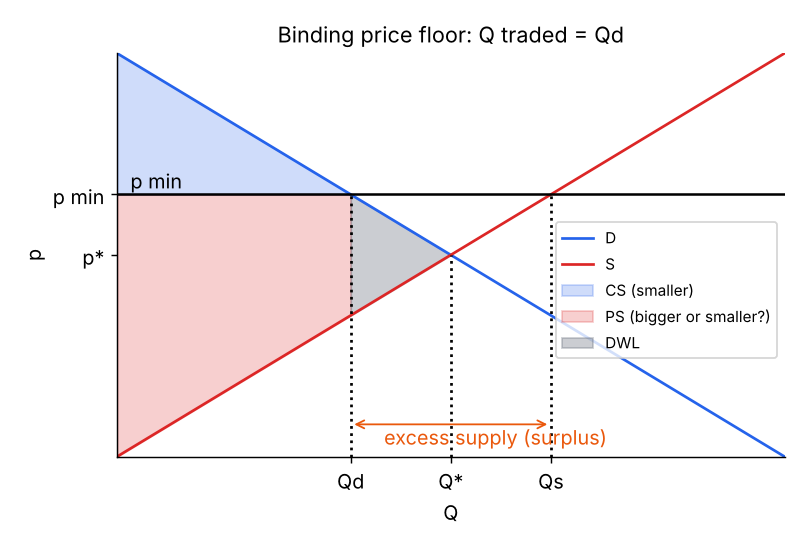
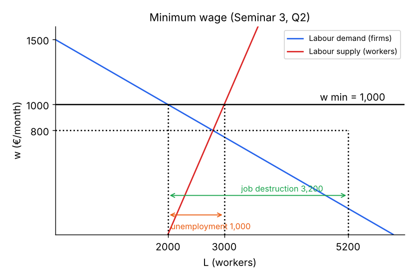
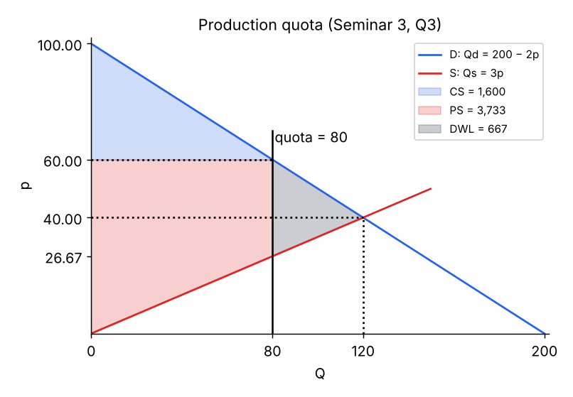

# Topic 3 – Market Interventions I

Question → answer notes, generated from the RECALL deck. ⭐ = asked in a past midterm.

## Intro: interventions & efficiency

**Q:** List the types of government market intervention.

**Maximum price** (ceiling), **minimum price** (floor), **production quotas**, **indirect taxes & subsidies**, **tariffs**, **import quotas** (+ regulation, public ownership).

**Q:** What is an **efficient allocation** of resources?

Resources in their **most efficient use**, all markets in **equilibrium (S = D)**, economy **on its PPC**, impossible to make someone better off without making someone worse off (**welfare maximised**).

**Q:** Market conditions required for efficiency?

**Perfect competition**, **perfect information**, **perfect mobility**, **consumer sovereignty**, **no externalities or public goods** – plus clear **price signals**.

**Q:** The **four functions** of government?

1. **Legislative/regulatory** (legal framework, competition, externalities)
2. **Allocative**
3. **Distributive** (equity)
4. **Stabilization**

## Externalities

**Q:** Define an **externality**.

When buying/selling decisions cause an **additional (external) cost or benefit on third parties**. **Social = private + external** costs/benefits.

**Q:** Give an example of each: +/− externality in production and consumption.

+ production: **R&D** · − production: **nuclear energy/pollution** · + consumption: **culture, education** · − consumption: **alcohol, drugs**.

**Q:** Why is the free market inefficient with externalities?

Agents **ignore external costs/benefits** → **too many** transactions with **negative** externalities, **too few** with **positive** ones.

**Q:** Battery: Anna's WTP €5, Berta's cost €4, price €4.5, external cost €2. Should society allow the trade?

Private surplus = **€1** < external cost **€2** → **inefficient**. Society could pay each **€0.75** not to trade and everyone is better off.

**Q:** First-aid course: Roger's WTP €100, cost €120, price €125, social benefit €30. Efficient?

Total value 100 + 30 = **130 > 120** cost → he **should** attend; market fails (positive externality). E.g. Roger pays €98, society €27.

## Maximum price (ceiling)

**Q:** When is a **price ceiling** binding and what happens?

Only if set **below equilibrium** → **Qd > Qs** → **shortage (excess demand)**; quantity traded = **Qs**.

**Q:** Are consumers better off with a ceiling? ⭐

**Ambiguous**: + they pay a **lower price**, − **less quantity** is available. The **more elastic supply**, the worse for consumers.

**Q:** Effect of a ceiling on producers?

**Worse off**: lower price **and** lower quantity → industry less profitable → **less investment**.

**Q:** Is a price ceiling more likely to benefit consumers when supply is **elastic or inelastic**? (Midterm 2023) ⭐

**Inelastic** supply – Qs falls **less**, so the quantity loss is small and the lower price dominates.

**Q:** Rent control: pros and cons?

Pros: limits price of a **basic good**, more **affordable**. Cons: **lower supply**, **black markets**, **lower quality** of dwellings, less mobility, discrimination.

> Slides: Kholodilin review of 196 studies → mostly negative effects. Catalonia study (Jofre-Monseny et al.): rents fell **4–6%** with **no evidence of reduced supply** – so evidence is mixed.

**Q:** Why can a **black market** emerge under a ceiling?

At the restricted quantity Qs, the **marginal WTP is far above** the legal price → buyers would pay more illegally.

**Q:** Real examples of maximum prices from the slides?

**Energy** (Ofgem cap, Spanish gas cap), **payday loans** (UK FCA: 0.8%/day), **rent controls**, **surgical masks** (Spain, €0.60).

## Minimum price (floor)

**Q:** When is a **price floor** binding and what happens?

Set **above equilibrium** → **Qs > Qd** → **excess supply (surplus)**; quantity traded = **Qd**. Sellers want to discount → hard to maintain.

**Q:** Who wins and loses with a price floor?

Consumers **worse off** (pay more, buy less). Producers **ambiguous** – higher price but sell less; depends on **price elasticity of demand**.

**Q:** What is a **guaranteed minimum price**? Problems?

Government **buys the excess supply**. Producers clearly better off, but **expensive**, high **welfare loss**, **perverse incentives** to overproduce, and what to do with the stock (old EU CAP).

**Q:** Examples of minimum prices?

**Agriculture** (EU, India), **alcohol** (Scotland, Ireland), **carbon allowances**, and the **minimum wage**.

**Q:** Minimum wage: pros and cons?

Pros: minimum income for **low-skilled**, more **equal** distribution, less **poverty**. Cons: higher labour cost → **unemployment** for some groups, firms substitute **capital** or **relocate**.

**Q:** Minimum wage diagram: job destruction vs unemployment? ⭐

**Job destruction** = Le − Ld (fall in employment). **Unemployment** = Ls − Ld (willing workers without jobs).

**Q:** Which elasticity limits **job destruction**? Which affects **unemployment**? (both midterms) ⭐

**Inelastic labour demand** → little job destruction. Unemployment is larger the **more elastic** labour **demand and supply**.

**Q:** What is the **Kaitz index**?

**Minimum wage / median (or average) wage × 100** – how 'high' a minimum wage is. Spain study: hit youth **16–19** most.

## Production quotas

**Q:** What is a **production quota** and when does it bind?

A **maximum quantity** that can be produced; binding only if set **below equilibrium Q**.

**Q:** Effects of a production quota?

Less exchanged + **higher price** → consumers **harmed**. Producers **indeterminate** (higher price, sell less). There is a **deadweight loss**.

**Q:** When are producers better off under a quota?

When demand is **inelastic** – the price rises a lot for a small cut in quantity, so revenue/PS rises.

**Q:** Real examples of production quotas?

**OPEC+** oil production cuts; **China rare-earth** quotas; EU agricultural quotas.

**Q:** Summary: aim and main problem of each price control?

**Max price** favours consumers → problem: **shortage, black market, low quality**. **Min price** favours producers → **overproduction, cost**. **Guaranteed min price** → **expensive, perverse incentives**.

