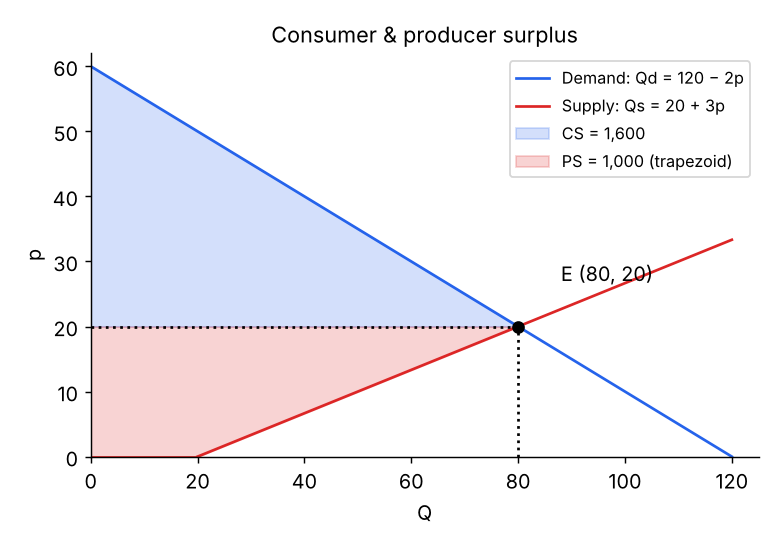

# Exam Practice – Seminars & Past Midterms

Question → answer notes, generated from the RECALL deck. ⭐ = asked in a past midterm.

## Seminar 1 – PPF & HHI

**Q:** HAL26: maths problem = 3 h, policy analysis = 12 h; 5 days 24/7. PPF?

Hours = 5 × 24 = **120** → **3M + 12P = 120** → **M + 4P = 40**; intercepts **M = 40**, **P = 10**; **P = 10 − 0.25M**.

**Q:** HAL26 analyses 7 policies. How many maths problems?

7 × 12 = 84 h → 36 h left → 36/3 = **12** problems.

**Q:** HAL26 opportunity costs?

OC(M) = 3/12 = **0.25 P**; OC(P) = 12/3 = **4 M**.

**Q:** Navojoa: 600 bars or 200 cups; Eldorado: 400 bars or 100 cups. OCs and comparative advantage?

Navojoa: bar = **1/3 cup**, cup = **3 bars**. Eldorado: bar = **1/4 cup**, cup = **4 bars**. → **Eldorado: bars**; **Navojoa: ice cream**.

**Q:** Joint company PPF (bars horizontal)?

Start (0, 300). Eldorado switches to bars first → kink **(400, 200)** → end **(1,000, 0)**. I = 300 − B/4 (0–400), I = 200 − (B − 400)/3 (400–1,000).

**Q:** Chora hotels revenues: A €3.6m, B €4.5m, C €3.0m, D €2.0m. HHI? After B + C merge?

Shares 27.48 / 34.35 / 22.90 / 15.27 → **HHI ≈ 2,693**. After merger (57.25%) → **≈ 4,266** (+1,573).

**Q:** OC of 1 car = 6 motorbikes; max 120 motorbikes. Producing 48 motorbikes, how many cars?

120 − 48 = 72 bikes' worth of resources → 72/6 = **12 cars**.

**Q:** Worker A: 20 emails or 5 memos per hour. Worker B's OC of an email = 0.4 memos. Who has the CA in emails?

A's OC of an email = 5/20 = **0.25 memos** < 0.4 → **A** in emails (B in memos).

**Q:** Daniela: 60 trousers/day, OC of trouser = 4 shirts. Sarah: 8 h × (10 trousers or 20 shirts). Joint PPF (trousers vertical)? (Midterm 2023) ⭐

Daniela: 60 T or **240 S**; Sarah: **80 T** or **160 S**. Max **140 T**, **400 S**. Kink at **(240 shirts, 80 trousers)** – Daniela makes shirts first (OC of shirt 0.25 T < 0.5 T).

**Q:** Bulgaria: 1,000 resources × (10 cars or 5 trucks); Romania: 800 × (18 cars or 6 trucks). Comparative advantage? Joint PPC (cars vertical)? (Midterm 2025) ⭐

OC(truck): BG = **2 cars**, RO = **3 cars** → **BG: trucks**, **RO: cars**. Max cars **24,400**, trucks **9,800**; kink at **(5,000 trucks, 14,400 cars)**.

## Seminar 2 – Elasticity

**Q:** Restaurant: €120 → €150, customers 200 → 180. PED? Good for revenue?

%ΔP = +25%, %ΔQ = −10% → **ε = −0.4** (inelastic). Revenue **€24,000 → €27,000** (+12.5%) → yes.

**Q:** Club: 120 people at €40, capacity 150, PED = −1.2. Price cut needed to fill it?

%ΔQ = +25% → %ΔP = 25/(−1.2) = **−20.83%** → cut **€8.33** → new fee **€31.67**.

**Q:** Q = 200 − 4p: PED from €20→€25 and from €40→€45?

20→25: Q 120→100 → −16.67%/25% = **−0.667** (inelastic). 40→45: Q 40→20 → −50%/12.5% = **−4** (elastic).

**Q:** Kentucky: PED(F&V) = −0.6; XED(fast food, P_F&V) = +0.05; subsidy cuts F&V price 10%. Effects?

F&V: (−0.6)(−10%) = **+6%**. Fast food: (+0.05)(−10%) = **−0.5%**.

**Q:** Montana: PED(F&V) = −0.7, XED(F&V, P_FF) = +0.15; F&V price −10%. Fast-food price rise needed for +12% F&V?

Own effect +7% → need +5% more → 5/0.15 = **+33.33%** fast-food price.

**Q:** Same subsidy in two states; demand more elastic in Montana. Compare.

Supply shifts right in both: Montana (elastic D) → **bigger Q ↑, smaller P ↓**; Kentucky (inelastic D) → bigger P ↓, smaller Q ↑.

**Q:** PED of Coke = −0.5; 200 cokes/day at €3 → €3.5. New revenue? (Midterm 2025) ⭐

%ΔP = +16.67% → %ΔQ = **−8.33%** → Q ≈ **183** → revenue 3.5 × 183 = **€640.5** (was €600).

**Q:** Price +10% leads to revenue −2%. PED? (Midterm 2025) ⭐

0.98 = 1.1 × Q₂/Q₁ → Q₂/Q₁ = 0.891 → %ΔQ = **−10.91%** → **ε = −1.09** (≈ −1.1).

> Trick: revenue = P × Q, so (1 + %ΔR) = (1 + %ΔP)(1 + %ΔQ). Solve for %ΔQ, then divide by %ΔP.

**Q:** Q = 500 − 5p: revenue-maximising price? (Midterm 2023) ⭐

ε = −5p/(500 − 5p) = −1 → 10p = 500 → **p = 50** (= a/2b).

**Q:** PED = −2.5; 300 sales at €20; new price €10. Daily revenue? (Midterm 2023) ⭐

%ΔP = −50% → %ΔQ = **+125%** → Q = **675** → revenue **€6,750** (was €6,000).

**Q:** PED(EV) = −0.97; XED(EV, P_gasoline) = 0.36. Gasoline cars −10%, EV price +20%. ΔQ of EVs? (Midterm 2023) ⭐

Cross: 0.36 × (−10%) = −3.6%. Own: −0.97 × 20% = −19.4%. Total **−23%**.

**Q:** At equilibrium p = €20, Q = 500, PED = −1.5. Qd rises 30%. Price change? PES if excess demand = 250? (Midterm 2023) ⭐

%ΔP = 30/(−1.5) = **−20%**. Qd = 650 → Qs = 400 → %ΔQs = −20% → **PES = +1**.

**Q:** Oil PED = −0.6, price +10%. % change in revenue? (Midterm 2023) ⭐

%ΔQ = −6% → 1.1 × 0.94 = 1.034 → revenue **+3.4%**.

**Q:** EV PED = −0.6; price €45,000, 2,000 units/month; price +€2,000. Revenue change?

%ΔP = +4.44% → %ΔQ = −2.67% → Q ≈ 1,946.7 → revenue **€90.0m → €91.49m** (+€1.49m, +1.66%).

**Q:** PED = −1.5; 10% price discount. % change in revenue?

%ΔQ = +15% → 0.9 × 1.15 = 1.035 → **+3.5%**.

## Equilibrium & welfare calculations

**Q:** Method: CS and PS with linear curves?

1. Solve **p\*, Q\***
2. Price-axis intercepts: set **Q = 0** in each equation
3. **CS = ½ (p_max − p\*) Q\***
4. **PS = ½ (p\* − p_min) Q\*** – if supply starts on the **Q-axis** (positive Q at p = 0), PS is a **trapezoid**

**Q:** Qd = 120 − 2p, Qs = 20 + 3p. Equilibrium, CS, PS?

**p = 20, Q = 80**. CS = ½(60 − 20)(80) = **1,600**. PS = trapezoid ½(20 + 80)(20) = **1,000**. TS = **2,600**.

**Q:** Same market (Qd = 120 − 2p, Qs = 20 + 3p), max price €16. New welfare?

Qs = **68**, Qd = 88 (shortage 20). WTP at 68 = **26**. CS = (26 − 16)·68 + ½(60 − 26)·68 = **1,836**. PS = ½(20 + 68)·16 = **704**. TS = **2,540** → DWL = **60**.

**Q:** p_d = 300 − 2Q, p_s = 100 + 3Q. Equilibrium and welfare?

300 − 2Q = 100 + 3Q → **Q = 40, p = 220**. CS = ½(80)(40) = **1,600**; PS = ½(120)(40) = **2,400**; TS = **4,000**.

**Q:** Peking duck: Qd = 80 − 2p, Qs = −20 + 3p. Equilibrium and welfare?

**p = 20, Q = 40**. CS = ½(40 − 20)(40) = **400**; PS = ½(20 − 6.67)(40) = **266.7**; TS = **666.7** (thousand CNY).

**Q:** Peking duck with a ceiling of CNY 12: quantities, shortage, CS, PS, DWL?

Qd = **56**, Qs = **16** → shortage **40**. WTP at 16 = 32. CS = 20·16 + ½·8·16 = **384**; PS = ½(12 − 6.67)·16 = **42.7**; DWL = **240**.

**Q:** Qd = 500 − 2p, Qs = −50 + 3p. Equilibrium and welfare? (Midterm 2025) ⭐

**p = 110, Q = 280**. CS = ½(250 − 110)(280) = **19,600**; PS = ½(110 − 16.67)(280) = **13,066.7**.

**Q:** Qd = 600 − 4p, Qs = 100 + 6p. Equilibrium and welfare? (Midterm 2023) ⭐

**p = 50, Q = 400**. CS = ½(150 − 50)(400) = **20,000**; PS = trapezoid ½(100 + 400)(50) = **12,500**; TS = **32,500**.

**Q:** Same market (Qd = 600 − 4p, Qs = 100 + 6p) with max price €20: quantities and CS? Improved? (Midterm 2023) ⭐

Qs = **220**, Qd = **520**. WTP at 220 = 95. CS = ½(130 + 75)(220) = **22,550** > 20,000 → consumers **better off** here.

## Seminar 3 – Interventions (worked)

**Q:** Housing: Qd = 60,000 − 20p, Qs = −20,000 + 30p. Equilibrium, CS, PS?

**p = €1,600, Q = 28,000**. Choke price 3,000; supply starts at 666.67. CS = ½(1,400)(28,000) = **€19.6m**; PS = ½(933.3)(28,000) = **€13.07m**.

**Q:** Housing with rent ceiling €1,000: CS, PS, DWL?

Qs = **10,000**, Qd = 40,000 (shortage 30,000). WTP at 10,000 = 2,500. CS = 1,500·10,000 + ½·500·10,000 = **€17.5m** (↓!). PS = ½(333.3)(10,000) = **€1.67m**. DWL = **€13.5m**.

> Here renters as a group are actually **worse off** (19.6m → 17.5m): supply is so elastic that the loss of 18,000 apartments outweighs the lower rent. With **more inelastic supply** fewer apartments would disappear and the ceiling would be more beneficial. Black market likely: the marginal renter would pay up to €2,500.

**Q:** Platform workers: Ld = 6,000 − 4w, Ls = 2,000 + w. Equilibrium? Minimum wage €1,000 → unemployment?

**w = €800, L = 5,200**. At €1,000: Ld = **2,000**, Ls = **3,000** → **unemployment 1,000**; job destruction 3,200.

**Q:** Platform workers: are workers better or worse off with the €1,000 minimum wage?

**Mixed**: the 2,000 who keep jobs earn more, 3,200 lose jobs. As a group worker surplus falls (≈ **€2.88m → €2.0m**); firms' surplus €1.82m → €0.5m.

> Worker surplus = area above labour supply, below the wage. Supply hits L = 2,000 at w = 0, so before: trapezoid ½(2,000 + 5,200)·800 = 2.88m. After (assuming the 2,000 lowest-reservation-wage workers keep the jobs): 2,000 × 1,000 = 2.0m.

**Q:** Apples: Qd = 200 − 2p, Qs = 3p. Equilibrium and welfare?

**p = 40, Q = 120**. CS = ½(100 − 40)(120) = **3,600**; PS = ½(40)(120) = **2,400**; TS = **6,000**.

**Q:** Apples with a production quota of 80: price and producer surplus?

Price from demand: 80 = 200 − 2p → **p = 60**. Supply price at 80 = 26.67. PS = 60·80 − ½·26.67·80 = **3,733** (↑ from 2,400). CS = **1,600**; DWL = **667**.

## Midterm Oct 2025 (BBA) – with solutions

**Q:** London luxury hotels: PED = −0.15, £250 a night, 200 rooms. Manager raises the price to £425. Change in daily revenue? (Midterm 2025, 10 marks) ⭐

%ΔP = **+70%** → %ΔQ = −0.15 × 70 = **−10.5%** → Q ≈ **179** rooms. Revenue £50,000 → £425 × 179 = **£76,075** (+**£26,075**).

> Marks: 2 for %ΔP, 3 for using the PED formula, 3 for the new Q, 2 for the change in revenue.

**Q:** Oasis plays in London (more hotel demand) while inspections temporarily close some hotels. New equilibrium? (Midterm 2025) ⭐

Demand **↑** (P↑ Q↑) + supply **↓** (P↑ Q↓) → **P ↑**, **Q uncertain**.

> Marks: 1 change in D, 1 change in S, 2 final effect on Q, 1 final effect on P. Draw S shifting left and D shifting right.

**Q:** Define opportunity cost and give two factors that **increase** the opportunity cost of **buying a flat**. (Midterm 2025) ⭐

OC = value of the next-best alternative given up. Factors: **interest rates ↑** (money could earn more elsewhere / borrowing dearer), **rents ↓** (renting becomes the cheaper alternative), **house prices in nearby cities ↓**.

> Marks: 2 for the definition, 3 for each correct factor.

**Q:** France: 100 resources × (6 solar panels or 3 turbines). Germany: 150 × (12 panels or 3 turbines). Comparative advantage? Joint PPC (panels vertical)? (Midterm 2025, 15 marks) ⭐

OC(turbine): France **2 panels**, Germany **4 panels** → **France: turbines**; **Germany: panels** (0.25 vs 0.5 turbines/panel). Max **2,400 panels**, **750 turbines**; kink at **(300 turbines, 1,800 panels)**; slopes **−2** then **−4**.

> Marks: 3 opportunity cost, 3 comparative advantage, 9 joint PPC. France (lowest OC of turbines) makes turbines first: gives up 600 panels for 300 turbines.

**Q:** Qd = 2,000 − 2p, Qs = 200 + 3p. Equilibrium and welfare? (Midterm 2025) ⭐

**p = 360, Q = 1,280**. Demand intercept p = 1,000. CS = ½(1,000 − 360)(1,280) = **409,600**. Supply starts at Q = 200 → PS trapezoid ½(200 + 1,280)(360) = **266,400**.

**Q:** Same market (Qd = 2,000 − 2p, Qs = 200 + 3p): price elasticity of demand and of supply at equilibrium? ⭐

Point formula: ε_D = −2 × 360/1,280 = **−0.5625** (inelastic); ε_S = 3 × 360/1,280 = **0.84**.

**Q:** Marginal analysis: how does employment change if (I) the **marginal product of labour** rises, (II) the **hourly wage** rises? (Midterm 2025) ⭐

(I) MPL ↑ → each worker adds more → **employment ↑**. (II) Wage ↑ → **employment ↓** (law of demand for labour).

> Firms hire until the value of the marginal product of labour = wage. Higher MPL raises what a worker is worth; a higher wage raises what a worker costs.

**Q:** Cross-price elasticity = −1.5. Complements or substitutes? (Midterm 2025) ⭐

**Complements** – the price of one ↑ → quantity of the other ↓ (negative XED).

**Q:** Minimum wage diagram: which areas change for workers and firms? (Midterm 2025, 15 marks) ⭐

Firms' surplus (CS) shrinks to the small triangle **above w_min**. Workers gain the rectangle **(w_min − w_e) × Ld** but lose the triangle from **job destruction** (Ld → Le). Marks: min wage 2, new Ld & Ls 3, CS 5, PS 5.

**Q:** Labour market: w = 2, L = 2,000, ε_D = −2, ε_S = 1.5. Minimum wage 2.5. Expected unemployment? (Midterm 2025, 15 marks) ⭐

%Δw = **+25%**. Ld: −2 × 25% = −50% → **1,000**. Ls: 1.5 × 25% = +37.5% → **2,750**. Unemployment = 2,750 − 1,000 = **1,750**.

> Marks: 3 change in wage, 5 use of both elasticities, 4 new Ls and Ld, 3 unemployment.

